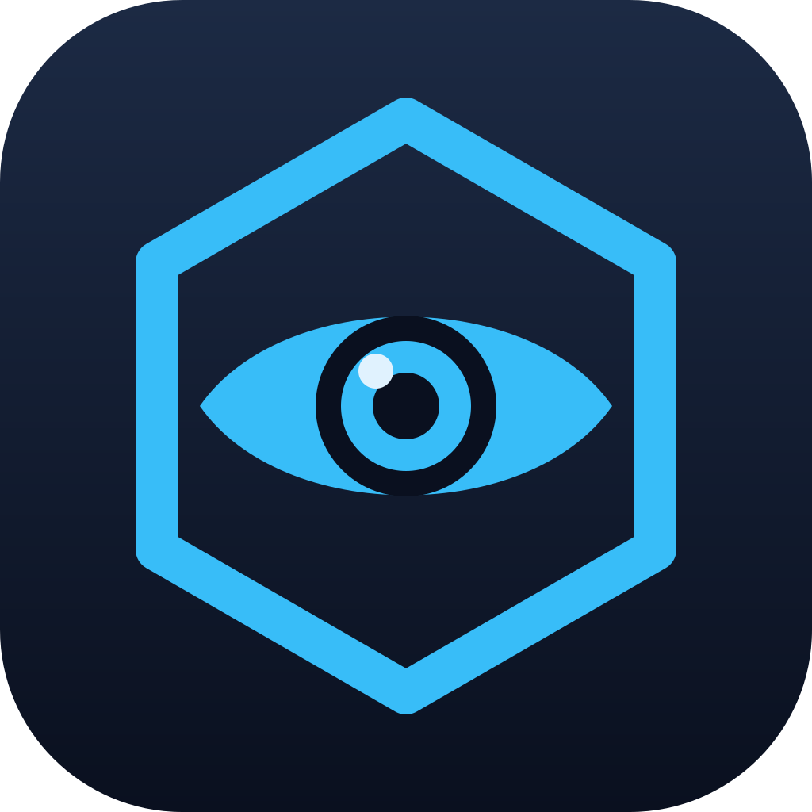

<p align="center">
  
</p>

# Sandbox Watcher

A cross-platform desktop app that shows what is happening in your running
[MaibornWolff Sandbox](https://github.com/MaibornWolff/sandbox) containers:
which projects have a sandbox up, which agents run inside, what they reach
on the network, and what they consume.

Status: milestone M5 (multi-runtime and platform parity). See [`docs/MILESTONES.md`](docs/MILESTONES.md)
for the plan and [`docs/adr/`](docs/adr/) for decisions.

## Layout

| Path                  | What                                                                                                                               |
| --------------------- | ---------------------------------------------------------------------------------------------------------------------------------- |
| `crates/sandbox-core` | Rust library: domain model, `RuntimeAdapter` contract, sandbox conventions, runtime detection, Docker/Podman adapter, mock adapter |
| `src-tauri`           | Tauri 2 shell exposing core functions as commands                                                                                  |
| `src`                 | React + TypeScript UI                                                                                                              |
| `fixtures/docker`     | Docker Engine API responses used by tests                                                                                          |
| `docs`                | Milestone plan and ADRs                                                                                                            |

## Develop

Requirements: Rust stable, Node 24, pnpm 12, and the
[Tauri prerequisites](https://v2.tauri.app/start/prerequisites/) for your OS.

```sh
pnpm install
pnpm tauri dev                 # live mode: Docker or Podman via the detected socket
pnpm tauri:dev:mock            # demo data from the mock adapter
```

Checks:

```sh
cargo test -p sandbox-core
# Adapter conformance against a real Docker daemon (needs a prepared container,
# see the core job in .github/workflows/ci.yml):
SANDBOX_WATCHER_DOCKER_TESTS=1 cargo test -p sandbox-core --test conformance
cargo clippy --all-targets -- -D warnings
pnpm lint && pnpm format:check && pnpm test && pnpm build
```

## Runtimes

Sandbox Watcher talks to the same runtimes sandbox does and finds them the
same way: `DOCKER_HOST`, then the usual sockets, then the binary on `PATH`.
When sandbox's user config sets `runtime`, only that runtime is used; set
`SANDBOX_WATCHER_RUNTIME` to override. Otherwise every runtime that answers
is shown, with a runtime chip on each container when there is more than one.

| Runtime           | How it is reached                                                                                                               | Notes                                                                                       |
| ----------------- | ------------------------------------------------------------------------------------------------------------------------------- | ------------------------------------------------------------------------------------------- |
| Docker            | Engine API over the socket, named pipe or `DOCKER_HOST`; the active `docker context` when only the binary is found              | Full support: events, stats, logs                                                           |
| Podman            | Docker-compatible API over the rootless or system socket, `CONTAINER_HOST`, or the machine socket from `podman machine inspect` | Full support                                                                                |
| Apple `container` | The `container` CLI (`list`, `inspect`, `exec`, `logs`, `stop`)                                                                 | No event stream and no stats; the Resources tab is hidden and the list refreshes by polling |

Conformance against real Docker and Podman runs in CI on Linux. Apple
`container` can only be verified on an Apple silicon Mac running macOS 26:

```sh
container run -d --name sandbox-watcher-test \
  --label sandbox.project=watcher-test --label sandbox.hash=abcdef123456 \
  alpine:3 sh -c 'mkdir -p /tmp/sandbox-sessions && touch /tmp/.sandbox-ready && sleep 600'
SANDBOX_WATCHER_DOCKER_TESTS=1 SANDBOX_WATCHER_RUNTIME=apple-container \
  cargo test -p sandbox-core --test conformance -- --nocapture
```

## Builds and releases

GitHub Actions builds everything. `CI` runs on every push and pull request:
Rust tests on macOS, Linux and Windows, the Docker conformance test on
Linux, web lint, tests and build, and an unsigned Tauri debug build per OS.
`Release` runs on tags `v*` (or manually) and attaches installers for macOS
(Apple silicon and Intel), Linux and Windows to a draft release. Bundles are
unsigned until milestone M7.

## Commits

Commit messages follow [Conventional Commits](https://www.conventionalcommits.org/)
and are checked by commitlint. Husky installs the hooks on `pnpm install`:
`pre-commit` runs lint and format check, `commit-msg` runs commitlint.
Pull requests are checked again in CI.

```sh
git commit -m "feat(core): add docker adapter"
git commit -m "fix(ui): keep stopped containers visible"
```

## License

MIT, see [`LICENSE`](LICENSE).

## Privacy

The app only talks to the local container runtime. It never reads
environment variable values from containers, only their names, and it sends
nothing anywhere.
